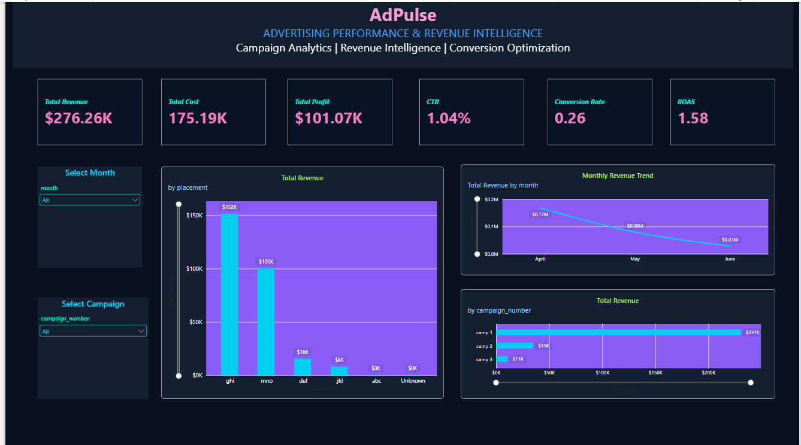
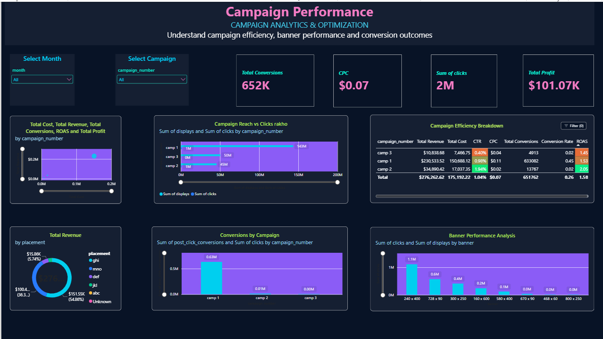

# AdPulse – Advertising Performance & Revenue Intelligence Dashboard

An interactive advertising analytics project built using **Microsoft Power BI, Power Query, and DAX** to analyze campaign performance, revenue generation, cost efficiency, and conversion outcomes.

## Project Overview

AdPulse is a two-page advertising performance dashboard designed to analyze campaign effectiveness through interactive visualizations and business-focused KPIs.

The dashboard provides insights into campaign revenue, advertising costs, profitability, click-through rates, conversion performance, and placement-level contribution.

## Dashboard Preview

### 1. Executive Overview



Provides a consolidated view of advertising performance through key metrics and visualizations.

**Key Highlights:**
- Total Revenue, Total Cost, and Total Profit
- Click-Through Rate (CTR)
- Return on Ad Spend (ROAS)
- Conversion Rate
- Monthly Revenue Trends
- Revenue by Campaign
- Revenue by Placement

### 2. Campaign Performance & Optimization



Provides detailed analysis of campaign-level performance and efficiency.

**Key Highlights:**
- Campaign Reach vs Clicks
- Banner Performance Analysis
- Conversions by Campaign
- Campaign Efficiency Breakdown
- Profitability Analysis
- Campaign Cost vs Revenue Analysis
- Interactive Month and Campaign Filters

## Key Performance Indicators (KPIs)

| KPI | Calculation |
|---|---|
| CTR | Clicks / Displays × 100 |
| CPC | Total Cost / Clicks |
| ROAS | Total Revenue / Total Cost |
| Conversion Rate | Total Conversions / Clicks × 100 |
| Profit | Total Revenue − Total Cost |

## Technology Stack

- **Microsoft Power BI** – Dashboard development and visualization
- **Power Query** – Data cleaning and transformation
- **DAX** – Measures and KPI calculations

## Data Preparation

The advertising dataset was processed before dashboard development.

Key preparation activities:
- Removed unnecessary empty columns.
- Handled missing placement values by categorizing them as `Unknown`.
- Removed duplicate records.
- Standardized data types.
- Prepared the dataset for analytical reporting.

## Interactive Features

- Month-based filtering
- Campaign-based filtering
- Dynamic KPI cards
- Interactive charts and tables
- Conditional formatting for performance comparison

## Business Value

AdPulse helps identify:
- Campaigns generating higher revenue and profitability.
- Differences in banner and placement performance.
- Campaigns with stronger click-through and conversion rates.
- Opportunities to improve advertising cost efficiency.
- Performance gaps requiring further investigation.

## Project Structure

```text
AdPulse-Advertising-Analytics/
│
├── Dashboard/
│   └── ADpulse-2.0.pbix
│
├── Dataset/
│   └── advertising_data.csv
│
├── Screenshots/
│   ├── executive-overview-v2.png
│   └── campaign-performance-v2.png
│
└── README.md
```

## How to Explore

1. Clone or download this repository.
2. Open `Dashboard/ADpulse-2.0.pbix` using Microsoft Power BI Desktop.
3. Explore the Executive Overview and Campaign Performance pages.
4. Use interactive slicers to filter campaigns and months.
5. Review the dataset and dashboard calculations.

## Project Scope & Limitations

This project focuses on advertising campaign performance and revenue analytics using the available dataset. It does not directly measure programmatic ad-serving metrics such as ad requests, fill rate, or publisher-side yield.

---

**Developed as a portfolio project to demonstrate advertising analytics, data preparation, KPI development, and interactive business intelligence reporting.**
